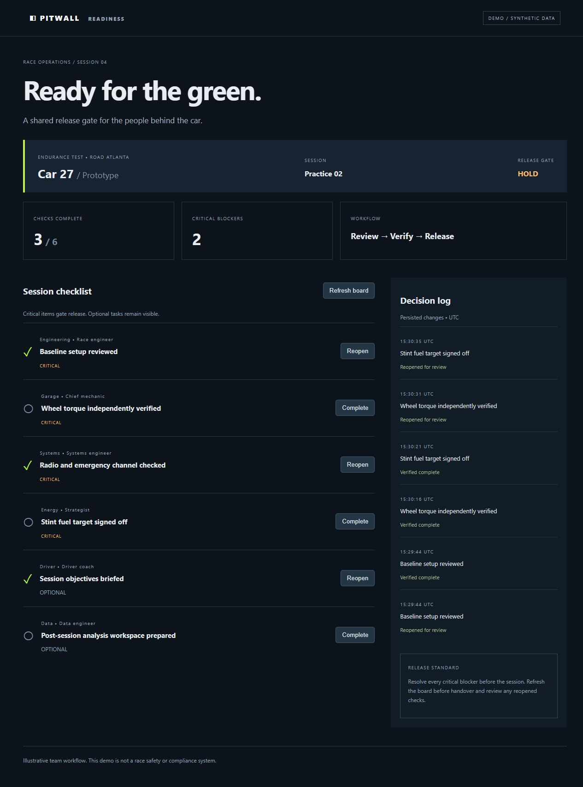
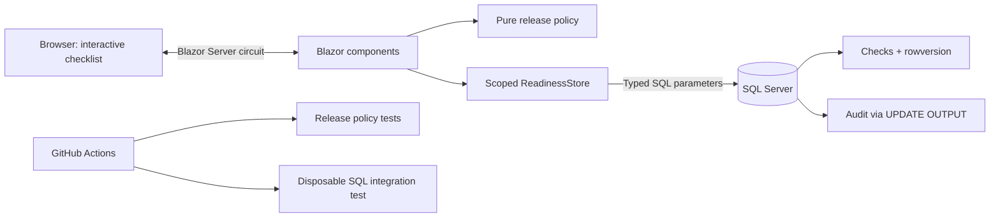

# Pitwall Readiness

A small Blazor / .NET 8 race-operations sample: review pre-session checks, resolve critical blockers, and inspect the persisted decision log. SQL Server is the source of truth; data access uses parameterized ADO.NET with Microsoft.Data.SqlClient. **No Entity Framework.** All teams, cars, and data are fictional.



## What to try

The seeded board opens on HOLD with two critical blockers. Complete both to reach CLEAR. Reopen a critical item to return to HOLD. Optional work does not gate release. Open two browser tabs and edit the same item: the stale tab receives a conflict message instead of silently overwriting the first update. Refresh exposes changes from other operators; live push is outside scope.

## Run locally

Prerequisites: .NET 8 SDK and ASP.NET Core 8 runtime; SQL Server 2022 / SQL Express or Docker; sqlcmd. The application targets net8.0 even when built with a newer compatible SDK.

1. Create a **dedicated** local database named `Pitwall` using your SQL administration tool or `sqlcmd -S localhost -E -b -Q "CREATE DATABASE Pitwall"`.
2. Apply the ordered scripts (Windows integrated authentication example):

   ```powershell
   sqlcmd -S localhost -E -b -d Pitwall -i database/001-schema.sql
   sqlcmd -S localhost -E -b -d Pitwall -i database/002-seed.sql
   ```

   For a local SQL container, use an explicitly chosen strong SA password and `docker run --name pitwall-sql -e ACCEPT_EULA=Y -e MSSQL_SA_PASSWORD -p 127.0.0.1:1433:1433 -d mcr.microsoft.com/mssql/server:2022-latest` after setting `MSSQL_SA_PASSWORD` in your environment. Wait until SQL accepts connections, then use `sqlcmd -S localhost,1433 -U sa -C -b` with the database and script options above; sqlcmd prompts for a password. Use SA only for setup, then create a least-privileged app login.
3. Configure the connection outside source control:

   ```powershell
   dotnet user-secrets set "ConnectionStrings:Pitwall" "Server=localhost;Database=Pitwall;Integrated Security=True;Encrypt=True;TrustServerCertificate=True" --project src/Pitwall
   dotnet restore Pitwall.sln
   dotnet build Pitwall.sln -c Release -warnaserror
   dotnet test Pitwall.sln -c Release --filter "Category!=SqlIntegration"
   dotnet run --project src/Pitwall --urls http://localhost:5080
   ```

   Open http://localhost:5080. User secrets load in Development: set `ASPNETCORE_ENVIRONMENT=Development` locally, or set the environment variable `ConnectionStrings__Pitwall` instead. TrustServerCertificate is for local development only. In deployment use a trusted SQL certificate and encryption.

4. Run SQL integration checks against a dedicated seeded test database:

   ```powershell
   $env:PITWALL_TEST_SQL = 'your test database connection string'
   dotnet test Pitwall.sln --filter "Category=SqlIntegration"
   ```

   The integration test changes and restores one item and adds audit records. Never run it against operational data. Missing configuration causes this test to fail rather than silently skip.

## Architecture



The release gate is derived from the current board. Empty or unavailable boards HOLD. Optimistic concurrency uses SQL `rowversion`; an update matches both ID and original token. A transaction captures UPDATE OUTPUT in a table variable and inserts the audit record before committing. Reads and writes open short-lived pooled connections. There is one fixed illustrative session, deliberately avoiding generic framework layers.

## SDLC evidence

- [Acceptance criteria and test plan](docs/acceptance.md)
- [Architecture decisions and operating limits](docs/architecture.md)
- CI builds with warnings as errors, runs unit tests, then checks real SQL update/audit/concurrency behavior in a separate job. Test results are uploaded even on failure.
- Database scripts are ordered, transactional and repeatable for this initial schema. Future schema changes require new numbered scripts and explicit migration review.

## Deployment boundary

This is a local engineering portfolio demo, **not an authenticated production service**. There is no login or verified operator identity; owner labels represent responsibility, not the person making a change. Keep it bound to localhost. Before hosting for a team, add identity, role-based authorization, trusted HTTPS, audit actor identity, SQL permissions, backups, monitoring, and reviewed deployment migrations. Do not place connection strings in GitHub or screenshots. `/health/live` reports process liveness only, not database readiness.

The app does not perform vehicle control, telemetry analysis, or certify race safety. CLEAR is an illustrative workflow state.

## References

- [Microsoft: Blazor render modes](https://learn.microsoft.com/aspnet/core/blazor/components/render-modes?view=aspnetcore-8.0)
- [Microsoft: SQL Server rowversion](https://learn.microsoft.com/sql/t-sql/data-types/rowversion-transact-sql)
- [Microsoft: OUTPUT clause](https://learn.microsoft.com/sql/t-sql/queries/output-clause-transact-sql)

See `docs/verification.md` for checks actually executed in the authoring environment. A workflow file is not evidence that hosted CI has passed.
